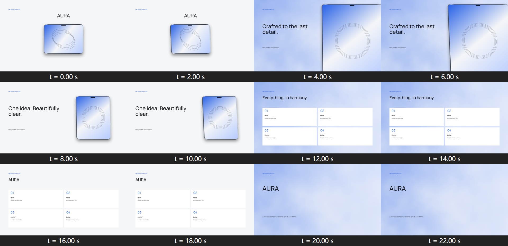
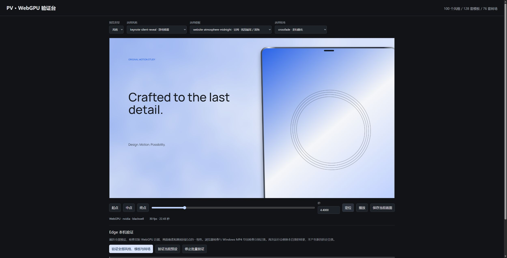

# Windows 验证记录 · 2026-10-18

版本 0.3.0。Windows x64，Go 1.27.0，Node 24.14.0，Multiplane 0.3.10，Playwright 1.63.0 / Chromium 153.0.8010.12，Edge 155，FFmpeg 9.0.2。实际原生 WebGPU 适配器为 NVIDIA / blackwell（RTX 5070 Ti，非 fallback adapter）。只使用 WebGPU / WGSL，不运行 GitHub Actions。

## 可重建案例

源码按 **`demo/{案例名字}/`** 保存：[案例索引](../demo/README.md)。四个项目都有本地字体、锁定依赖、HTML、数据 JSON 与 WGSL，可独立复制运行。

| 案例 | 输出规格 | 确定性验证 |
| --- | --- | --- |
| keynote-product · 产品揭幕 | 1080p / 30fps / 673 帧 | 全部输出帧时刻 |
| anime-character · 原创角色介绍 | 1080p / 30fps / 318 帧 | 全部输出帧时刻 |
| game-trailer · 游戏概念预告 | 1080p / 30fps / 342 帧 | 全部输出帧时刻 |
| website-background · 水下光纹 | 1080p / 30fps / 180 帧 | 全部输出帧时刻及周期端点 |

**MP4 不提交 Git，也不进入 skill ZIP。** 视频与依赖、渲染日志和缓存留在各案例忽略目录。每个案例均为 draft 设计示意；角色是静态生成立绘，游戏案例没有实机玩法证据，产品形体为程序化示意，未配商业音乐。发布需要另行确认权利、事实与审片批准。产品案例复用与其所有声明输入文件 SHA-256 完全相同的已验证渲染，并重新检查 MP4；证据见 [案例报告](validation/demo-report.json)。



## 自动化范围

| 范围 | 结果与覆盖 |
| --- | --- |
| 数据 | 100 风格、128 模板、76 转场、33 场景、12 背景严格检查；100×128 共 12,800 个风格/模板组合 |
| Deep 编码语料 | 2,640 个案例，83 批真实 MP4；2,640 次像素检查、150 次转场端点比较、116 次周期比较 |
| Edge 操控 | 全部 1,368 案例运行两轮；逐帧哈希与源码/数据指纹比较，304 次回跳检查/轮 |
| 网站实际播放 | 自动播放、静音、两次真实循环、无控件、无鼠标/键盘交互、内联、海报、解码、前景点击命中 |
| Windows QA | `go vet`、全部 Go 测试连续两轮，共 216 次测试通过事件、0 跳过、0 失败；真实媒体与 GPU 故障夹具、全库缓存复验、四个案例 MP4 完整解码 |
| MP4 反例 | 容器截断、错误编码/像素格式、多视频/音轨、无视频、音画漂移、损坏 H.264 数据、VFR 均拒绝 |
| GPU 反例 | 无效 WGSL、状态依赖动画、WebGPU 不可用、设备丢失、未经批准发布均拒绝 |
| 幂等 | 全库固定缓存复验，前后 5,795 个文件集合与内容哈希相同，新增批次 0；四个实际案例交付包重复打包不变，临时夹具自动清理 |
| Race | Go race detector + CPU/真实媒体夹具；GPU 故障夹具单独验证 |

报告：[目录](validation/catalog-report.json) · [Edge](validation/edge-report.json) · [两轮比较](validation/edge-repeat-report.json) · [背景播放](validation/background-report.json) · [Windows QA](validation/go-tests.json) · [幂等](validation/idempotency-report.json) · [race](validation/race-tests.json) · [源码打包补验](validation/source-packaging-report.json) · [画廊来源](style-gallery/provenance.json)。精确测试事件数、跳过范围和逐项结果以对应 JSON 为准。测试通过事件包括子用例与重复运行，不表示 216 个不同测试函数。



运行：

```powershell
go run . setup --shared
go run . qa windows --deep
# 已导出案例后追加本地 MP4 验证：
go run . qa windows --deep --samples demo/keynote-product/deliverables/master.mp4,demo/anime-character/deliverables/master.mp4,demo/game-trailer/deliverables/master.mp4,demo/website-background/deliverables/master.mp4
```

## 验证边界

Deep 把每个场景三个时刻、转场五个阶段、循环起止和风格关键帧组织为 720p/6fps 图集，每个案例成为实际编码帧。它覆盖数据与算法，不能解释为 100 风格或 128 模板各自完整影片均按最终帧率导出。Edge 使用 GPU 读回检查画面和回跳一致性；它与 MP4 编码、人工审美审片各自独立。

风格文件包含可执行渲染参数，也包含需要真实素材/三维模型/摄影/配乐实现的导演方向。关键词不会自动生成这些素材。HyperFrames 等用于工作流研究；当前实际 HTML 导出后端为锁定的 Multiplane，没有声称已集成 HyperFrames 导出器。

游戏引擎只交付普通 H.264/yuv420p MP4 和海报/报告，没有 Unity 脚本或 SDK。尚未验证 macOS、Linux、移动浏览器和全部游戏引擎。中文/日文需要已授权本地字体。自动测试不构成商业发布审批。

## 幂等与保留

Go 夹具在 `t.TempDir()` 中创建视频/音轨并自动清理。全目录复验只保留 `work/catalog-validation`，重查源码、PNG 哈希与完整媒体解码；代码变化不允许复用。显式数据更新模式只允许复用逐项数据完全相同的已完成用例。浏览器和 Windows QA 报告原位替换。Bundle 使用固定目录、哈希复用和暂存自动清理，并保留未知用户文件。24 个并发报告写入有原子替换测试。

真实创作导出由项目保存，拒绝覆盖已有 MP4；这与临时自动化夹具不同。过时的测试图集可回收清理，用户素材和创作母版不自动删除。
