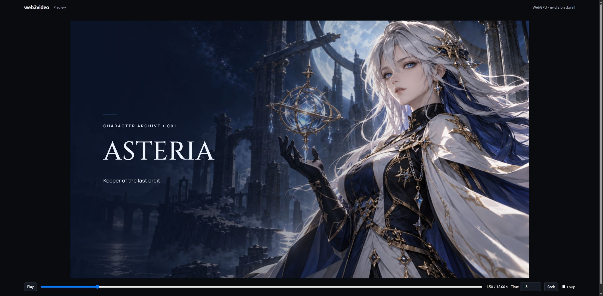
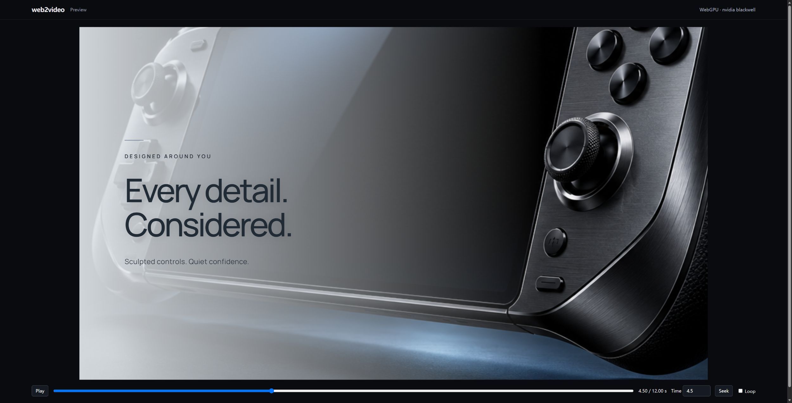
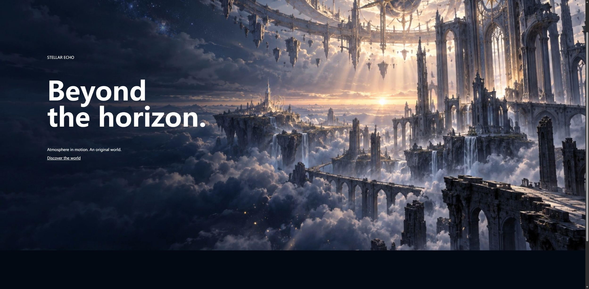

# Windows validation — web2video 1.0.0

Validated locally on 2026-10-19 (Asia/Shanghai), using Go 1.27.0, Node.js
24.14.0, HyperFrames 0.8.171, GSAP 3.14.2, Chrome Headless Shell
152.0.7977.30, FFmpeg 9.0.2 and an NVIDIA RTX 5070 Ti. Interactive preview and
website playback were operated in Edge 155. No GitHub Actions were used.

## Actual exports

| Example | Resolution / cadence | Duration | Decoded frames | Result |
| --- | --- | --- | --- | --- |
| keynote-product | 1920×1080 / 30 fps | 12 s | 360 | H.264/yuv420p, silent, fast-start, full decode |
| anime-character | 1920×1080 / 30 fps | 12 s | 360 | H.264/yuv420p, silent, fast-start, full decode |
| game-trailer | 1920×1080 / 30 fps | 12 s | 360 | H.264/yuv420p, silent, fast-start, full decode |
| website-background | 1920×1080 / 30 fps | 6 s | 180 | H.264/yuv420p, silent, fast-start, full decode |

Every generated scene's midpoint is decoded to pixels and checked for spatial
variation. This caught and fixed a real first-scene black-frame bug caused by
omitting a zero start time in JSON. MP4 box parsing and decoding alone would not
have caught it. Source changes during capture also caused a staged export to be
discarded, as intended.

The MP4s remain in each demo's ignored `renders/` directory. None is tracked or
included in the release ZIP. Compact machine-readable evidence is in
`validation/windows.json` and `validation/idempotence.json`.

## Automation

```powershell
go test -count=1 ./...
web2video qa --media --gpu --catalog
$env:CGO_ENABLED='1'
go test -race -count=1 ./...
```

- All 100 style recipes built and captured through native WebGPU: **100 distinct
  PNG pixel hashes**.
- All 76 transition presets captured through native WebGPU: **76 distinct PNG
  pixel hashes**. The WGSL module compiles all 48 algorithms.
- Website loop snapshots at **0 s and 6 s are byte-identical**.
- Real GPU export verified, then repeated without changing files.
- Invalid WGSL and an unavailable adapter failed without publishing an MP4;
  a previously valid output survived the failed replacement.
- Owned temporary browser/history jobs are identified by PID and checked for
  cleanup. Failed jobs remove their stage and lock.
- Actual VFR, incompatible pixel formats/codecs, ambiguous streams, corrupt
  boxes, missing audio and audio drift are rejected.
- FFmpeg archive checks cover ranges, checksums, dependency preservation and
  traversal rejection. Preview checks cover read-only routes and private paths.
- Each finished demo was re-rendered twice via cache reuse and fully decoded
  again. File counts and complete file-content hashes stayed unchanged.
- Repeated release packaging produced identical executable and ZIP hashes.

Native HyperFrames checks sampled all four examples, including transition
boundaries: zero runtime, layout or motion errors; zero runtime or contrast
warnings. The GPU-only website loop retains one `sweep_static` layout warning:
the DOM geometry is stationary while pixels move inside the WebGPU canvas.
Separate PNG checks prove its midpoint differs and its endpoints match. Lint
retains **5 / 5 / 5 / 1 structural recommendations** about
splitting the flat source into sub-compositions. These are recorded recommendations;
the native error gate passes. No warning-free lint claim is made.

## Edge operation

All four previews displayed the actual `WebGPU · nvidia blackwell` backend,
correct duration, working play/pause and time seeking. Their current pages had
no console errors or warnings. The website used the exported MP4 with
`readyState=4`, `paused=false`, `muted=true`, `loop=true`, `inert`,
`tabindex=-1`, `playsinline` and `pointer-events:none`. Its foreground link
remained clickable.







These examples use original generated still artwork with camera movement,
typography and shader transitions. They are concept films, not gameplay footage,
skeletal character animation or proof of real product performance. The 100-style
pixel sweep verifies execution and variation, not an artistic quality score.
