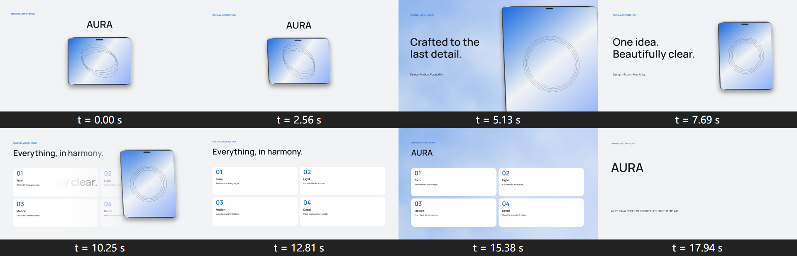

# Windows 验证记录 · 2026-10-18

版本 0.2.0。平台 Windows x64，Go 1.27.0，Node 24.14.0，Multiplane 0.3.10，Playwright 1.63.0 / Chromium 153.0.8010.12，Edge 155，FFmpeg 9.0.2。原生 WebGPU 适配器为 NVIDIA / blackwell（RTX 5070 Ti）。项目不使用 WebGL2 回退，不运行 GitHub Actions。

## 实测结果

| 范围 | 结果 |
| --- | --- |
| 128 模板 JSON、76 转场 JSON、33 场景、12 背景 | 数据预检通过 |
| Deep 全目录 | 2,140 案例，65 批真实 MP4，全部通过 |
| 静帧像素检查 | 2,140 帧通过；150 次共同转场端点比较、16 次循环接缝比较通过 |
| Edge 操控验证 | 968 帧案例通过：全部模板起点/中点/末帧/回跳，全部转场五阶段/回跳 |
| 网站背景实际播放 | 自动播放、静音、两次真实循环、无控件、无鼠标/键盘交互、内联、海报、解码、前景命中均通过 |
| 临时渲染集成测试 | 连续两轮通过；H.264/AAC、完整帧覆盖、解码与失败门禁 |
| 打包集成测试 | 连续两轮通过；website/Unity、无音轨背景、哈希复用、损坏修复、Range、暂存清理 |
| 幂等全库复验 | 重新核对所有已完成批次并解码；4,705 文件前后集合/内容哈希一致，新增批次 0 |
| Go 单元测试、vet、skill 格式检查 | 通过 |

原始汇总：[目录](validation/catalog-report.json) · [Edge](validation/edge-report.json) · [背景播放](validation/background-report.json) · [幂等](validation/idempotency-report.json) · [样片导出摘要](validation/sample-reports.json)。本地完整证据保留在固定的 work 子目录；仓库不提交缓存静帧和 node_modules。

## 可播放样片

| 样片 | MP4 | 确定性检查覆盖 |
| --- | --- | --- |
| 发布会产品示意 | [20.5 秒 / 615 帧](keynote-demo.mp4) | 全部 615 个输出帧时刻 |
| 原创角色介绍 | [16.8 秒 / 504 帧](character-demo.mp4) | 全部 504 个输出帧时刻；公开样片去除测试音轨 |
| 无烘焙文字官网背景 | [6 秒 / 180 帧](shader-demo.mp4) | 全部 180 个输出帧时刻 |
| 全部 76 转场运动演示 | [62.2 秒 / 1,866 帧](transitions-demo.mp4) | 显式 78 时刻：首尾及每个转场中点 |

所有 MP4 均为 1920×1080、30fps、H.264/yuv420p，完成实际视频流/帧数核对和完整 FFmpeg 解码。角色集成测试的 AAC 使用合成测试音，公开样片保持静音；它不是配乐示例。样片为 draft 视觉示意，素材与真实性需按实际宣传项目审片。

## 验证边界

Deep 将每个场景的三个时刻、转场五个阶段、循环起止组成 720p/6fps 测试图集，每个案例写入实际 MP4。它覆盖全库数据与算法，并非把 128 部影片全部按最终帧率导出。Edge 为真实 WebGPU 读回和时间回跳检查，不能替代编码检查或人工审美审片。故障门禁实际注入了无效 WGSL、状态依赖动画、缺少 WebGPU、设备销毁和未批准发布，均被拒绝。

Unity 交付包的媒体与文件生成已验证；未在 Unity Editor 或目标设备中编译/播放辅助脚本。尚未验证 macOS、Linux、移动浏览器和全部游戏引擎。中文/日文字体需要项目自行加入本地授权字体。

## 幂等与清理

测试项目、音轨和 MP4 使用 `t.TempDir()`；正常/失败退出均由 Go testing 清理。目录复验使用一份固定缓存，只有源码、采样、PNG/媒体均匹配才复用。浏览器报告/当前画面原位替换，打包使用固定目录和自动清理暂存。已删除开发中早期试验目录，保留最终样片源项目、一份完整目录证据及浏览器证据。创作导出与批准记录应由项目保存，不当作测试垃圾删除。
